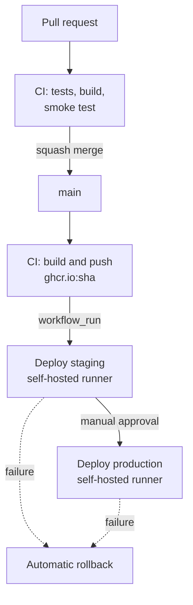

# Todo App: multi-environment CI/CD pipeline

[](https://github.com/nadiatouaiti/todo-app-cicd/actions/workflows/ci.yml)
[](https://github.com/nadiatouaiti/todo-app-cicd/actions/workflows/cd.yml)

A Node.js todo application shipped through a complete CI/CD pipeline:
tests on every pull request, an immutable Docker image per commit,
automatic deployment to staging, and production after manual approval,
with health checks, automatic rollback and a one-click manual rollback.

Built as a hands-on DevOps project to practise every step end to end.

## Pipeline



| Stage | What happens |
|---|---|
| **CI** (`ci.yml`) | Jest tests, Docker build, container smoke test (waits for `healthy`, then a real POST/GET). On `main`, pushes the image tagged with the commit SHA. |
| **CD** (`cd.yml`) | Triggered when CI succeeds on `main`. Deploys the **same image** to staging, then to production once approved. |
| **Rollback** (`rollback.yml`) | Manual workflow: redeploy any previous SHA to staging or production. |

## Key practices

- **Build once, promote the same artifact**: one image per commit, tagged with its SHA, deployed unchanged from staging to production.
- **Protected `main`**: changes only through pull requests, with required checks (`test`, `build`) and squash merges.
- **Gated production**: GitHub Environments with a required reviewer; every approval is recorded.
- **Health checks everywhere**: a `/health` endpoint checks the app and its database; a Docker `HEALTHCHECK` uses it; deployments wait for the `healthy` state.
- **Automatic rollback**: if a new version is not healthy, the previous image is restarted and the job stays red so the failure is visible. Tested with fault injection (`SIMULATE_DEPLOY_FAILURE` on staging only).
- **Safe manual rollback**: validated SHA input, shared concurrency lock with the CD, audit-friendly run names.
- **Disk hygiene**: only the current and previous images are kept on each server.
- **Security**: non-root container, least-privilege `GITHUB_TOKEN`, self-hosted runners only used for `push` events on `main`, approval required for external contributors, **0 known vulnerabilities in production dependencies** (`npm audit --omit=dev`).
- **Pinned tooling**: `ubuntu-24.04` runners and versioned actions, so the pipeline does not change unexpectedly.

## Infrastructure

| Environment | Host | Runner label |
|---|---|---|
| Staging | Ubuntu VM (Multipass) | `[self-hosted, staging]` |
| Production | Ubuntu VM (Multipass) | `[self-hosted, prod]` |

The runners poll GitHub over outbound HTTPS, so the VMs need no inbound access.

## Repository layout

```
.github/workflows/
  ci.yml             tests, build, smoke test, push to ghcr.io
  cd.yml             staging → approval → production, auto-rollback
  rollback.yml       manual rollback to any SHA
scripts/
  wait-healthy.sh    waits for a container to report "healthy"
  cleanup-images.sh  removes old images, keeps current and previous
src/                 application (Express + SQLite/MySQL)
spec/                Jest tests
Dockerfile
```

## Run locally

```bash
nvm use            # Node version from .nvmrc
npm ci
npm test
SQLITE_DB_LOCATION=/tmp/todos/todo.db node src/index.js
curl localhost:3000/health
```

With Docker:

```bash
docker build -t todo-app .
docker run -d --name todo -p 3000:3000 -v todo-db:/etc/todos todo-app
./scripts/wait-healthy.sh todo
```

## Lessons learned

- A deployment can fail for reasons outside the code (a DNS failure on a VM): pulling the image *before* stopping the old container meant the service was never affected.
- A rollback restores the code, not the data: database changes must stay compatible with the previous version.
- A closed security alert is not a fixed production system until the fix is deployed.
- Inherited `overrides` pinned to exact versions ended up blocking security fixes; they were removed and the reason documented.

## Next steps

- Factor the deployment steps into a reusable composite action.
- Deploy the same application to Kubernetes with Helm and ArgoCD (GitOps).

## Credits

Application based on [docker/getting-started-app](https://github.com/docker/getting-started-app) (MIT).
The CI/CD pipeline, scripts and infrastructure are my own work.
